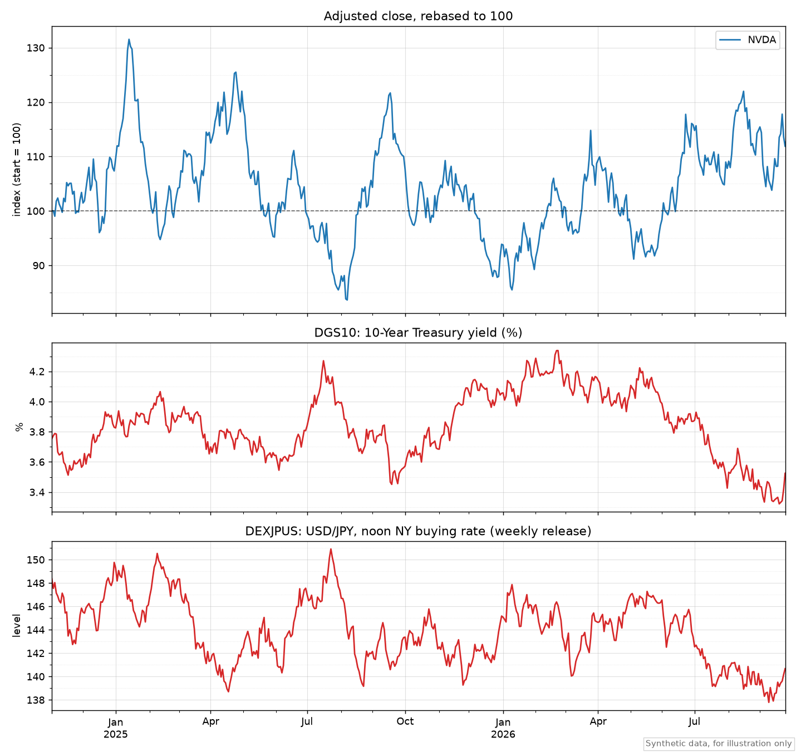
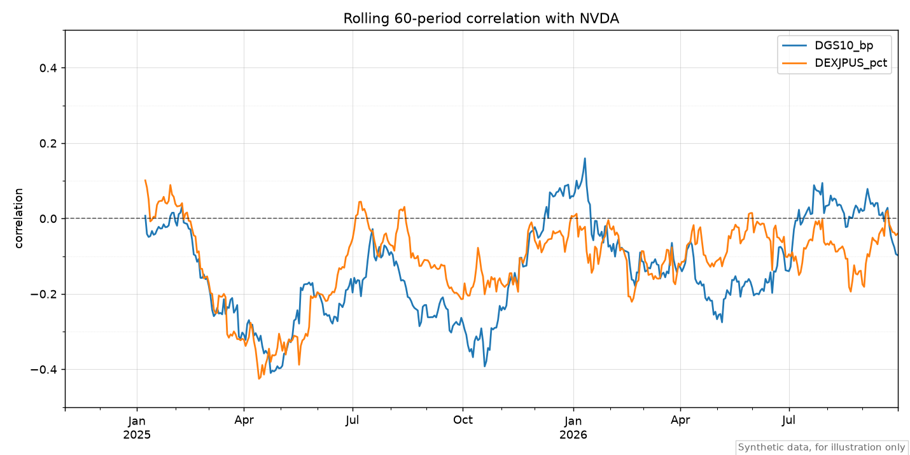
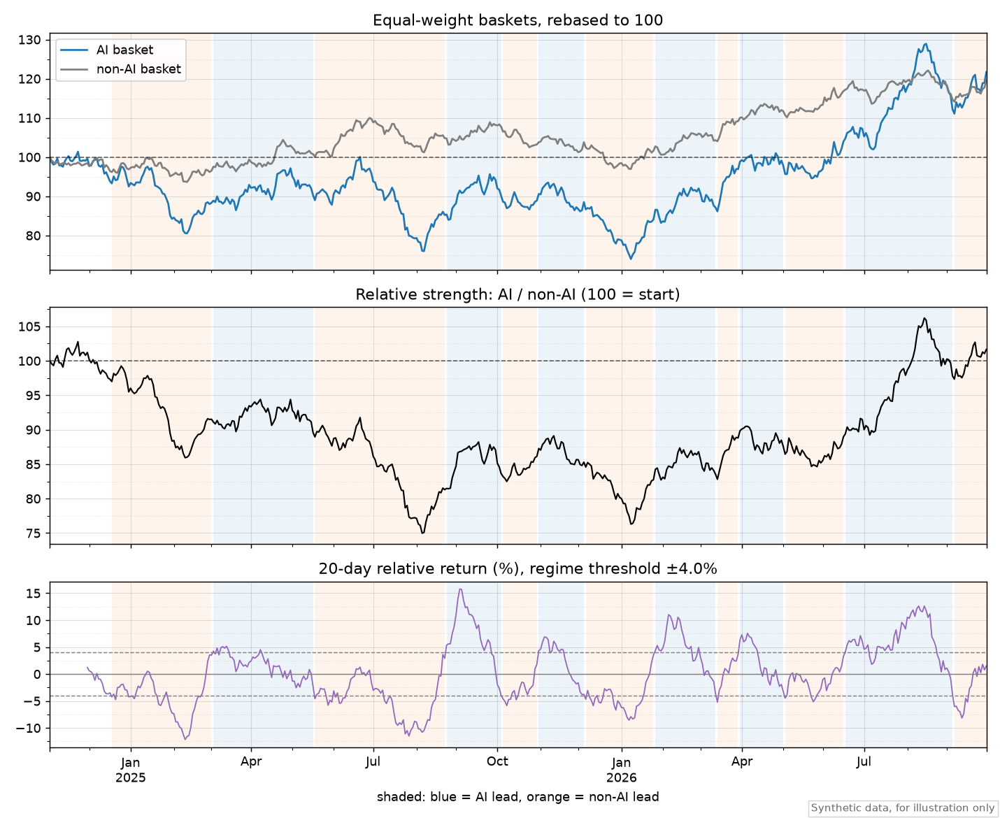
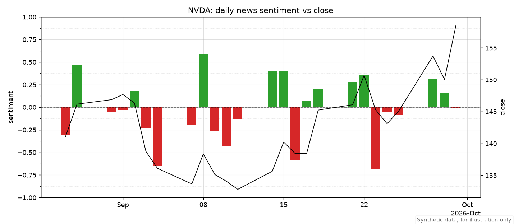

# US Market Agent

A personal setup that turns [Cursor](https://cursor.com) into a US equity research assistant.
Ask questions in chat, such as "How sensitive is NVDA to the 10-year yield lately?" or
"Are AI stocks leading or lagging the rest of the market?", and the agent fetches data,
runs the numbers in code, and answers with charts and stated data freshness.

It combines:

- **[Alpaca's official MCP server](https://github.com/alpacahq/alpaca-mcp-server)**, read-only,
  for snapshots, market movers, news and option data
- **A Python CLI (`mkt`)** that stores Alpaca daily bars and news plus [FRED](https://fred.stlouisfed.org/)
  series (Treasury yields, USD/JPY, dollar index, VIX) in DuckDB, and runs the analysis and charts
- **Cursor rules and skills** that define repeatable analysis workflows and answer formats

> **Disclaimer.** This is a personal tool for gathering and analyzing information on US stocks,
> shared for reference only. It is **not investment advice**. All investment decisions are your
> own responsibility, and the author accepts **no liability** for any loss arising from its use.
> See [DISCLAIMER.md](DISCLAIMER.md) (English / 日本語).

## Design principles

- **Code does the math, not the LLM.** MCP is used for small, exploratory lookups; anything
  quantitative goes through the CLI so results are reproducible.
- **Read-only by construction.** The MCP server only exposes data toolsets (`ALPACA_TOOLSETS`);
  trading, account and watchlist tools are not loaded, and the rules forbid placing orders.
- **Always state freshness.** Answers include sources, as-of dates and known lags.
- **Secrets stay local.** Keys live only in `.env`, which is git-ignored and read by both the
  MCP server and the CLI.

## What it can do

| Area | Command / skill |
| --- | --- |
| Market overview (indices, movers, rates, USD/JPY, VIX) | `market-snapshot` |
| Stock sensitivity to yields and USD/JPY (rolling correlation, HAC regression, rate regimes) | `mkt analyze cross-asset`, `macro-cross-asset` |
| AI vs non-AI leadership rotation (ETF baskets, relative strength, regime detection) | `mkt analyze rotation`, `ai-rotation` |
| News sentiment scored by the agent with a fixed rubric, compared with returns | `mkt sentiment ...`, `news-sentiment` |
| Briefing on articles you paste or link, checked against market data | `article-briefing` |
| Single-ticker deep dive and a Cursor Canvas dashboard | `mkt export dashboard`, `ticker-deep-dive` |

## Requirements

- macOS or Linux, [uv](https://docs.astral.sh/uv/), Python 3.12
- [Cursor](https://cursor.com)
- An [Alpaca](https://app.alpaca.markets/signup) paper trading account (free) and API keys
- A [FRED API key](https://fredaccount.stlouisfed.org/apikeys) (free)

## Setup

```bash
git clone https://github.com/yuuKimy/us-market-agent.git
cd us-market-agent
uv sync
cp .env.example .env   # then fill in the keys
```

`.env`:

```bash
ALPACA_API_KEY=...
ALPACA_SECRET_KEY=...
ALPACA_DATA_FEED=iex   # paper-only accounts get IEX data
FRED_API_KEY=...
```

Check that both data sources work:

```bash
uv run mkt fetch macro
uv run mkt fetch bars SPY QQQ
uv run mkt status
```

Then open this folder as the Cursor workspace. The project-level `.cursor/mcp.json` starts the
Alpaca MCP server with `uvx`; in Cursor's MCP settings, `alpaca` should show 35 read-only tools.

## Using the skills

Skills live in `.cursor/skills/`. With this folder open as the workspace, just ask in the agent chat:
Cursor picks the matching skill from its description. You can also name it explicitly, e.g.
"Use the `ai-rotation` skill". Questions can be in any language. The answer templates in the
skills are written in Japanese, so add "answer in English" if you prefer English output.

Every answer states its sources and as-of dates and ends with a not-investment-advice note.

### `market-snapshot`: market overview

> How did the US market do today? Include NVDA, MSFT and XLE.

The agent checks the market clock (MCP), refreshes and summarizes index ETFs
(`SPY QQQ IWM DIA TLT`) plus your tickers with `mkt snapshot`, pulls top movers and headlines
from MCP, and reads 2y/10y yields, the 2s10s spread, USD/JPY and VIX from FRED.

### `macro-cross-asset`: sensitivity to yields and USD/JPY

> How sensitive is NVDA to the 10-year yield and USD/JPY over the last two years?

The agent runs `mkt analyze cross-asset NVDA --series DGS10 DEXJPUS --plot`: an OLS of daily
returns on yield changes (bp), USD/JPY changes (%) and SPY, with HAC standard errors, plus
full-period and rolling correlations and a rising-vs-falling-rates comparison. You get the
coefficients translated into plain terms (for example, "about -0.4% per +10bp beyond the market
move, t = -2.2") and the charts shown below.

### `ai-rotation`: AI vs the rest of the market

> Are AI stocks leading or lagging the rest of the market right now? Since when?

The agent runs `mkt analyze rotation --plot`. AI (`SMH QQQ`) and non-AI (`RSP IWM XLV XLP XLU`)
equal-weight baskets are compared through their relative strength; a regime flips when the
20-day relative return crosses ±4% (with hysteresis). You get the current regime and its age,
past regime segments with the yield/USD/JPY/VIX moves during each, which ETFs are driving, and
news around the latest switch.

### `news-sentiment`: scored news vs returns

> Score this week's NVDA and AMD news and compare it with the price moves.

The agent fetches Alpaca (Benzinga) news, lists unscored articles in batches of 30
(`mkt news unscored`), scores each article for each ticker with a fixed rubric (-1 to +1,
confidence, event type, one-line rationale, no lookahead), imports the scores
(`mkt sentiment import`), and runs `mkt sentiment summary --plot`. Articles published at or after
16:00 ET count toward the next session. Scoring reads every article, so start with one or two
tickers and a week or two of news.

### `article-briefing`: briefing on articles you provide

> Here are two articles: https://... https://... What do they mean for semiconductor stocks?

The agent reads the pages (paywalled ones must be pasted as text), separates facts, company
statements and opinions, maps the story to tickers, sector ETFs and macro channels, measures the
price reaction since publication against the sector and SPY, cross-checks other news and upcoming
events, and gives a directional read of the news (positive to negative, with confidence),
upside/downside scenarios and what to watch. It never gives buy/sell calls or price targets.

### `ticker-deep-dive`: full single-ticker report and dashboard

> Do a deep dive on NVDA and build a dashboard.

Combines the skills above with corporate actions and option implied volatility from MCP, and
writes a Cursor Canvas dashboard with `mkt export dashboard ... --canvas-dir <canvases dir>`.
The dashboard has a snapshot table, rebased prices, macro series, rolling correlation, the
regression table and sentiment bars over the close price, with gridlines and hover values.

## Sample output

The images and numbers in this section come from **synthetic data**, not real prices. They are
generated by `uv run python scripts/generate_readme_samples.py` (fixed seed, no API keys), which
builds a temporary database and runs the same CLI commands the agent uses.

### Cross-asset sensitivity

`mkt analyze cross-asset NVDA --series DGS10 DEXJPUS --plot`





```text
## OLS NVDA_pct ~ DGS10_bp + DEXJPUS_pct + SPY_pct (HAC SE) | n=494 R2=0.386 | 2024-11-04..2026-09-24
               coef        t       p
const       -0.0269  -0.3570  0.7211
DGS10_bp    -0.0377  -2.1570  0.0310
DEXJPUS_pct -0.1909  -1.0974  0.2725
SPY_pct      1.5349  18.5135  0.0000
```

Read as: holding the market constant, a +10bp move in the 10-year yield goes with about -0.38%
for this stock (t = -2.2); the USD/JPY effect is not significant. The regression ends on
2026-09-24 because the weekly USD/JPY series lags the other data.

### AI vs non-AI rotation

`mkt analyze rotation --plot`



```text
## current
        regime       since  days  rel_20d_%  rs_5d_%  rs_21d_%  rs_63d_%
0  non-AI lead  2026-09-07    18      1.498    0.865     1.387    12.517

## summary
                   period  switches  ai_lead_share_%  median_segment_days
0  2024-12-18..2026-09-30        12           48.069                 32.0
```

Shaded bands are detected regimes (blue: AI lead, orange: non-AI lead). Detection lags the actual
turn because it waits for the 20-day relative return to cross the threshold.

### News sentiment vs price

`mkt sentiment summary NVDA --plot`



Bars are the confidence-weighted daily sentiment (left axis); the line is the close (right axis).

## CLI overview

```bash
uv run mkt fetch bars NVDA SPY               # adjusted daily bars (incremental; --full to rebuild)
uv run mkt fetch macro                       # FRED catalog: DGS3MO DGS2 DGS10 DGS30 T10Y2Y DFII10 DEXJPUS DTWEXBGS VIXCLS
uv run mkt fetch news NVDA --start 2026-10-01
uv run mkt snapshot NVDA SPY
uv run mkt analyze cross-asset NVDA --series DGS10 DEXJPUS --plot
uv run mkt analyze rotation --plot
uv run mkt sentiment summary NVDA --plot
uv run mkt export dashboard NVDA SPY --canvas-dir ~/.cursor/projects/<workspace-slug>/canvases
uv run mkt query "SELECT * FROM bars_daily LIMIT 5"
```

Charts are written to `reports/` as PNG. Run `uv run mkt --help` for all options.

## Project layout

```
AGENTS.md                      # instructions for the agent (Japanese)
.cursor/mcp.json               # Alpaca MCP, read-only toolsets, keys from .env
.cursor/rules/                 # answer rules: sources, as-of, no buy/sell calls
.cursor/skills/                # analysis workflows
src/market_agent/
  clients/{alpaca,fred}.py     # data fetchers
  store.py                     # DuckDB schema and queries
  indicators.py                # returns, correlation, regression, regimes, rotation
  sentiment.py                 # score validation, session mapping, aggregation
  plots.py                     # matplotlib charts
  templates/                   # Cursor Canvas dashboard template
  cli.py                       # `mkt` entry point
scripts/generate_readme_samples.py  # rebuilds docs/images from synthetic data
docs/images/                   # README sample charts (synthetic data)
tests/
```

`data/` (DuckDB) and `reports/` (charts, score files) are local only and git-ignored.

## Using it from another project

The package can be installed into a separate project (for example, a research repository),
pinned to a commit:

```bash
uv add "market-agent @ git+https://github.com/yuuKimy/us-market-agent@<commit>"
```

`.env`, `data/` and `reports/` are then resolved from `MARKET_AGENT_HOME` if set, otherwise
from the current working directory. When running from this checkout, they stay in the repository
root as before.

## Data notes and limitations

- **IEX feed.** Alpaca paper-only accounts receive IEX data: history starts on 2020-07-27, and
  volume covers only IEX, so volume is used in relative terms.
- **USD/JPY lag.** FRED's `DEXJPUS` is released weekly, so it can be up to a week behind.
  Lagging series are never forward-filled past their last observation.
- **No FX or yield history on Alpaca.** Yields and USD/JPY come from FRED.
- **Sentiment scores are LLM judgments** made with the rubric in `news-sentiment`; treat small
  samples as anecdotal.
- **Data is not redistributed.** Follow the Alpaca and FRED terms of use; fetched data stays local.

## Development

```bash
uv run pytest
uv run ruff check .
```

Tests cover pure calculation logic only; no test calls external APIs.
After changing charts, refresh the README images with
`uv run python scripts/generate_readme_samples.py`.

## License

[MIT](LICENSE)
